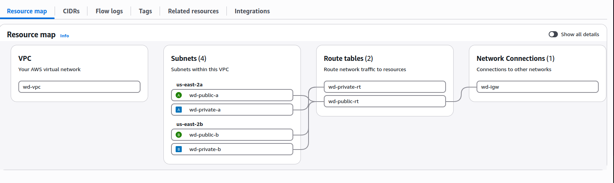
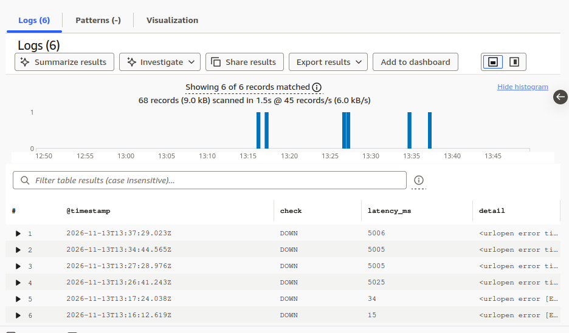

# AWS VPC Watchdog
A two-tier VPC with a public web server, an isolated private server,
and a serverless uptime monitor. Built by hand in the AWS console.

## Architecture


## What I built
- Custom VPC (10.0.0.0/16), 4 subnets across 2 AZs, IGW, public and private route tables
- EC2 web server (Apache via user data) in a public subnet
- EC2 private server reachable only through the web server's security group
- Lambda health check every 5 minutes via EventBridge, logs in CloudWatch

## Key decisions
- No NAT Gateway: private server needs no internet, which keeps cost near $0
- Lambda outside the VPC: tests the site the way a real user would
- Security-group referencing instead of IP rules for east-west traffic

## Failure testing

I broke the environment three ways and used the watchdog Lambda to record how each failure looked from the outside.

| # | What I broke | Result | Latency | Error | Layer at fault |
|---|---|---|---|---|---|
| 1 | Stopped Apache (`httpd`) | DOWN | 15 ms | Connection refused | Application |
| 2 | Removed HTTP 80 rule from `wd-web-sg` | DOWN | 5,025 ms | Timed out | Firewall (security group) |
| 3 | Moved `wd-public-a` off the public route table | DOWN | 5,005 ms | Timed out | Network path (routing) |

**Key takeaway:** a fast *connection refused* means the network worked and the application was down. A ~5 s *timeout* means something in the path silently dropped the traffic. Tests 2 and 3 look identical from the outside, so a timeout tells you *that* something is blocking traffic, not *what*. The next step is to check the security group, then the route table, then the network ACL.

---

### Test 1: Stopped Apache

| | Action | Result |
|---|---|---|
| **Break** | `sudo systemctl stop httpd` | DOWN · Connection refused · 15 ms |
| **Fix** | `sudo systemctl start httpd` | UP · 200 OK · 16 ms |

**Lesson:** the request reached the server, but nothing was listening on port 80, so the OS refused it immediately.

<details>
<summary>Raw Lambda output</summary>

**Broken**
```json
{
  "check": "DOWN",
  "url": "http://3.147.57.157/health",
  "status_code": null,
  "latency_ms": 15,
  "detail": "<urlopen error [Errno 111] Connection refused>"
}
```

**Fixed**
```json
{
  "check": "UP",
  "url": "http://3.147.57.157/health",
  "status_code": 200,
  "latency_ms": 16,
  "detail": "OK"
}
```
</details>

### Test 2: Removed security group rule

| | Action | Result |
|---|---|---|
| **Break** | Deleted inbound rule `HTTP / 80 / 0.0.0.0/0` from `wd-web-sg` | DOWN · Timed out · 5,025 ms |
| **Fix** | Re-added inbound rule `HTTP / 80 / 0.0.0.0/0` | UP · 200 OK · 30 ms |

**Lesson:** security groups don't reject traffic, they silently drop it. The client waits until its own timeout (5 s) expires.

<details>
<summary>Raw Lambda output</summary>

**Broken**
```json
{
  "check": "DOWN",
  "url": "http://3.147.57.157/health",
  "status_code": null,
  "latency_ms": 5025,
  "detail": "<urlopen error timed out>"
}
```

**Fixed**
```json
{
  "check": "UP",
  "url": "http://3.147.57.157/health",
  "status_code": 200,
  "latency_ms": 30,
  "detail": "OK"
}
```
</details>

### Test 3: Cut the route to the internet

| | Action | Result |
|---|---|---|
| **Break** | Re-associated `wd-public-a` with `wd-private-rt` (no `0.0.0.0/0 → IGW` route) | DOWN · Timed out · 5,005 ms |
| **Fix** | Re-associated `wd-public-a` with `wd-public-rt` | UP · 200 OK · 5 ms |

**Lesson:** a public IP and an open security group aren't enough. Without a route to the Internet Gateway, return traffic has no way out. This is what makes a subnet "private."

<details>
<summary>Raw Lambda output</summary>

**Broken**
```json
{
  "check": "DOWN",
  "url": "http://3.147.57.157/health",
  "status_code": null,
  "latency_ms": 5005,
  "detail": "<urlopen error timed out>"
}
```

**Fixed**
```json
{
  "check": "UP",
  "url": "http://3.147.57.157/health",
  "status_code": 200,
  "latency_ms": 5,
  "detail": "OK"
}
```
</details>

### Incident evidence

Every DOWN event, pulled from CloudWatch Logs Insights by filtering the Lambda's structured JSON logs:




